  
  

  

 

 

  <!-- Frontend -->
  
  
  
  
  
  
  

  <!-- Backend -->
  
  
  
  

  <!-- Banco de Dados -->
  
  
  

  <!-- DevOps / Cloud / Infraestrutura -->
  
  
  
  

  <!-- SO / Ambiente -->
  
  
  

  <!-- Versionamento / Ferramentas -->
  
  
  
  
  
  
  

<table>
  <tr>
    <td width="35%" align="center">
      
    </td>
    <td width="65%">
      

        
<b>🇧🇷 Português</b>

        <h2>Mensagem aos Recrutadores</h2>
        

          Olá! Me chamo <strong>Wesley Najar</strong>, desenvolvedor full-stack com mais de <strong>4 anos de experiência</strong> e atuação também como <strong>Arquiteto de Software</strong>. Hoje participo da concepção de novos produtos, do levantamento das necessidades de negócio e da definição de requisitos até o desenho da solução, o desenvolvimento, a validação e o deploy.
        

        
<b>O que eu posso entregar para o seu time:</b>

        <ul>
          <li><b>Arquitetura e produto:</b> análise de requisitos funcionais e não funcionais, modelagem de dados, integrações e avaliação de alternativas técnicas, sempre alinhando as decisões técnicas aos objetivos do produto.</li>
          <li><b>Desenvolvimento full-stack:</b> Laravel/PHP e Vue.js (também React e Node.js), com SQL Server, PostgreSQL e MySQL.</li>
          <li><b>Performance:</b> redução de 30% no tempo de resposta de consultas SQL, com análise, indexação e refatoração de procedures.</li>
          <li><b>Cloud e infraestrutura:</b> AWS (EC2, RDS, Auto Scaling e Load Balancer), Docker, Linux, Nginx, Apache, SSL e deploys.</li>
          <li><b>Colaboração:</b> contato direto com clientes, ambiente ágil (certificado em Scrum) e integração de soluções de IA e machine learning em aplicações.</li>
        </ul>
        

          Se você busca alguém que una código de qualidade com visão de produto e de negócio, vai ser um prazer conversar. Me chama! 😄
        

        

          <i>📝 Obs: muitos dos meus projetos mais completos e bem elaborados estão privados, pois foram desenvolvidos sob demanda para clientes e, por questões contratuais e de confidencialidade, não posso divulgá-los publicamente.</i>
        

      

      

        
<b>🇺🇸 English</b>

        <h2>Message to Recruiters</h2>
        

          Hello! My name is <strong>Wesley Najar</strong>, a full-stack developer with more than <strong>4 years of experience</strong>, also working as a <strong>Software Architect</strong>. Today I take part in the conception of new products, from identifying business needs and defining requirements to solution design, development, validation, and deployment.
        

        
<b>What I can bring to your team:</b>

        <ul>
          <li><b>Architecture and product:</b> functional and non-functional requirements analysis, data modeling, integrations, and evaluation of technical alternatives, always aligning technical decisions with product goals.</li>
          <li><b>Full-stack development:</b> Laravel/PHP and Vue.js (also React and Node.js), with SQL Server, PostgreSQL, and MySQL.</li>
          <li><b>Performance:</b> 30% reduction in SQL query response time through analysis, indexing, and stored procedure refactoring.</li>
          <li><b>Cloud and infrastructure:</b> AWS (EC2, RDS, Auto Scaling, and Load Balancer), Docker, Linux, Nginx, Apache, SSL, and deployments.</li>
          <li><b>Collaboration:</b> direct contact with clients, agile environment (Scrum certified), and integration of AI and machine learning solutions into applications.</li>
        </ul>
        

          If you are looking for someone who combines quality code with product and business vision, it will be a pleasure to talk. Reach out! 😄
        

        

          <i>📝 Note: many of my most complete and well-crafted projects are private, since they were developed on demand for clients and, for contractual and confidentiality reasons, I cannot make them public.</i>
        

      

      

        
<b>🇪🇸 Español</b>

        <h2>Mensaje a los Reclutadores</h2>
        

          ¡Hola! Me llamo <strong>Wesley Najar</strong>, desarrollador full-stack con más de <strong>4 años de experiencia</strong> y con funciones de <strong>Arquitecto de Software</strong>. Actualmente participo en la concepción de nuevos productos, desde la identificación de las necesidades de negocio y la definición de requisitos hasta el diseño de la solución, el desarrollo, la validación y el despliegue.
        

        
<b>Lo que puedo aportar a tu equipo:</b>

        <ul>
          <li><b>Arquitectura y producto:</b> análisis de requisitos funcionales y no funcionales, modelado de datos, integraciones y evaluación de alternativas técnicas, siempre alineando las decisiones técnicas con los objetivos del producto.</li>
          <li><b>Desarrollo full-stack:</b> Laravel/PHP y Vue.js (también React y Node.js), con SQL Server, PostgreSQL y MySQL.</li>
          <li><b>Rendimiento:</b> reducción del 30% en el tiempo de respuesta de consultas SQL, mediante análisis, indexación y refactorización de procedimientos almacenados.</li>
          <li><b>Cloud e infraestructura:</b> AWS (EC2, RDS, Auto Scaling y Load Balancer), Docker, Linux, Nginx, Apache, SSL y despliegues.</li>
          <li><b>Colaboración:</b> contacto directo con clientes, entorno ágil (certificado en Scrum) e integración de soluciones de IA y machine learning en aplicaciones.</li>
        </ul>
        

          Si buscas a alguien que combine código de calidad con visión de producto y de negocio, será un placer conversar. ¡Escríbeme! 😄
        

        

          <i>📝 Nota: muchos de mis proyectos más completos y elaborados son privados, ya que fueron desarrollados a pedido para clientes y, por motivos contractuales y de confidencialidad, no puedo divulgarlos públicamente.</i>
        

      

    </td>
  </tr>
</table>

  

  
  
  

